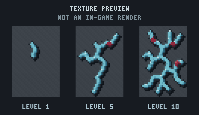
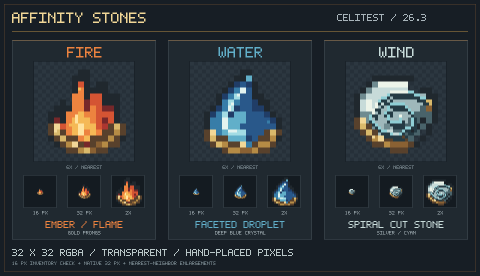

# Celi's Mage Chronicles

**Celi's Mage Chronicles** is a Fabric magic expansion for Minecraft 26.3. It adds a crystal-and-ruby progression system, mana-powered armor upgrades, affinity-based staff abilities, custom Ruby equipment, and the Mage's Altar.

> **Development status:** This project is actively evolving. The repository contains the implemented systems and static checks, but a fresh Minecraft runtime test is still recommended after pulling changes.

## Features

### Magical progression

- Mine **Magerald Ore** and collect Magerald Shards.
- Craft **Magerite Clusters** from Magerald Shards and Refined Ruby.
- Use the **Mage's Altar** to attach up to ten Magerite Clusters to each armor piece.
- See Magerite progression as branching blue-and-ruby veins embedded in armor.

### Mana and enchantments

- Start with **50 maximum mana**.
- Gain mana capacity from equipped Magerite armor.
- Regenerate mana passively every ten game ticks.
- Use **Mana Store I–III** to increase an armor piece's Magerite contribution.
- Use **Mana Regen I–V** to increase equipped mana regeneration.
- View current and maximum mana in the in-game mana bar.

### Affinity magic

Choose one active affinity at the Mage's Altar:

| Affinity | Primary ability | Secondary ability |
| --- | --- | --- |
| Fire | Fireball | Inferno |
| Water | Water Orb | Thunderstorm |
| Wind | Wind Burst | Skyward Ascent |
| Earth | Earth Shard | Thornvine Prison |

The Mage's Staff uses the selected affinity for its left-click and right-click abilities. Earth adds a heavy shard projectile and a thorn-vine prison that immobilizes nearby enemies, damages them over time, and returns a portion of actual thorn damage as healing.

### Equipment

- Mage's Staff with custom visual components.
- Ruby tools and armor.
- Charged Ruby Axe throwing and area damage mechanics.
- Affinity Stones for Fire, Water, Wind, and Earth.

## Requirements

- Minecraft **26.3**
- Fabric Loader **0.19.5 or newer**
- Fabric API
- Java **25 or newer**

The versions used by this project are recorded in [`gradle.properties`](gradle.properties).

## Installation

1. Install a Minecraft 26.3 Fabric profile with Java 25.
2. Install the matching Fabric API release.
3. Download the latest Celi's Mage Chronicles jar from the repository's Releases page once a release is published.
4. Place the mod jar in the Minecraft `mods` folder.
5. Start the Fabric profile.

For development setup, see [`docs/getting-started.md`](docs/getting-started.md).

## Building from source

On Windows:

```powershell
\.\gradlew.bat build
```

On macOS or Linux:

```bash
./gradlew build
```

The remapped jar is produced under `build/libs/`.

## Documentation

- [Documentation index](docs/README.md)
- [Getting started](docs/getting-started.md)
- [Gameplay guide](docs/gameplay.md)
- [Systems and code map](docs/architecture.md)
- [Visual previews](docs/visuals.md)
- [Credits](docs/credits.md)
- [Detailed magic-system specification](docs/magic-system-spec.md)

## Preview

### Magerite armor veins



### Affinity Stones



The preview sheets are design and texture references rather than guarantees of final in-game rendering.

## Credits

Made by **Celi/Himadri**.

Contact: [hsg090907.jsr@gmail.com](mailto:hsg090907.jsr@gmail.com)

Built with the Fabric toolchain and Minecraft's modding APIs.

## License

This project currently uses the **CC0-1.0** license. See [`LICENSE`](LICENSE) for the full text.
