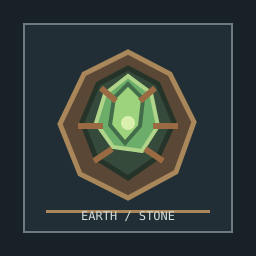

# Visual References

The repository includes lightweight preview sheets for the main visual directions. They are kept under `docs/previews/` so they render directly in GitHub documentation.

## Magerite armor veins

The armor direction uses dark recessed cracks, light-blue Magerite filling, and restrained ruby-red pockets. The pattern expands as cluster upgrades increase.

## Affinity Stones

This sheet documents the pixel-art direction for the elemental stones. Earth Stone resources are now included in the mod alongside Fire, Water, and Wind.

### Earth Stone concept

The Earth concept uses a rocky brown casing, muted green foliage tones, and a pale central crystal to support Earth Shard and Thornvine Prison's visual identity.

## Asset locations

- Item textures: `src/main/resources/assets/celitest/textures/item/`
- Armor equipment textures: `src/main/resources/assets/celitest/textures/entity/equipment/`
- Item definitions: `src/main/resources/assets/celitest/items/`
- Item models: `src/main/resources/assets/celitest/models/item/`
- Block textures: `src/main/resources/assets/celitest/textures/block/`

The preview sheets are design references. Always verify final scale, transparency, item definitions, and in-game readability after asset changes.
